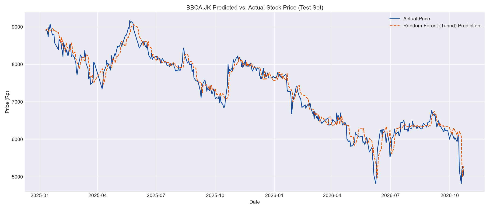

# 📈 BCA Stock Predictor: BBCA Stock Price Forecasting with Machine Learning (Python + Streamlit)

A data science portfolio project that forecasts the share price of **PT Bank Central Asia Tbk (BBCA)** using historical data from **Yahoo Finance** and a machine learning approach.


🔗 **Live demo:** https://bca-stock-predictor-demo1d.streamlit.app

## 📝 Overview

This project analyzes BBCA's historical stock prices since 2015, builds several prediction models (Linear Regression and a tuned Random Forest), and compares their performance when forecasting the closing price several days ahead.

> 💡 **Version note:** This project deliberately **does not use TensorFlow/LSTM**, so it runs on the latest Python versions (including 3.13/3.14), where TensorFlow is not always available right away. The main model is a **Random Forest** tuned with `GridSearchCV`. If you use Python 3.9–3.12, feel free to add an LSTM model yourself (see the [Roadmap](#-roadmap)).

> ⚠️ **Disclaimer:** This project was created for educational and portfolio purposes only. The predictions are **not** investment or trading advice. Always do your own research (DYOR) before making any financial decision.

## 🛠️ Tech Stack

| Category         | Tools/Libraries                                                  |
|------------------|------------------------------------------------------------------|
| Language         | Python 3.10+                                                     |
| Editor           | Visual Studio Code (with the Jupyter extension)                  |
| Notebook         | Jupyter Notebook / JupyterLab                                    |
| Data source      | [Yahoo Finance](https://finance.yahoo.com/) via `yfinance`       |
| Data processing  | `pandas`, `numpy`                                                |
| Visualization    | `matplotlib`, `seaborn`, `plotly`                                |
| Machine Learning | `scikit-learn` (Linear Regression, Random Forest + GridSearchCV) |
| Dashboard        | `streamlit`                                                      |
| Version control  | Git & GitHub                                                     |

## 🚀 Getting Started (in VS Code)

1. **Clone this repository**

   ```bash
   git clone https://github.com/techrick-rgb/BCA-Stock-Predictor.git
   cd BCA-Stock-Predictor
   ```

2. **Create a virtual environment** (recommended)

   ```bash
   python -m venv venv
   # Windows
   venv\Scripts\activate
   # macOS/Linux
   source venv/bin/activate
   ```

3. **Install dependencies**

   ```bash
   # Dashboard only (lightweight)
   pip install -r requirements.txt

   # Notebook + development tools (includes the above)
   pip install -r requirements-dev.txt
   ```

4. **Open the folder in VS Code**

   ```bash
   code .
   ```

   Make sure the **Python** and **Jupyter** extensions are installed in VS Code.

5. **Run the notebook**

   - Open `notebooks/BCA_Stock_Prediction.ipynb`
   - Select the Python kernel (the virtual environment you just created)
   - Run the cells in order (`Run All`)

   The notebook automatically downloads the latest BBCA data from Yahoo Finance when it runs (an internet connection is required).

## 🖥️ Interactive Dashboard (Streamlit)

Besides the notebook, there is an interactive **Streamlit** dashboard (`app.py`) that wraps the same pipeline (fetch data → feature engineering → Random Forest → forecast) into a local web app you can click through, with no need to open the notebook.

**Dashboard features:**

- Set the historical start date and the number of forecast days from the sidebar
- Interactive price chart with moving averages (Plotly, with zoom and hover)
- Real-time model evaluation metrics (RMSE, MAE, MAPE, R²)
- Predicted vs. actual chart on the test set
- Feature importance
- N-day-ahead price forecast with a button to download the results as CSV

**How to run:**

```bash
# make sure the virtual environment is active and requirements.txt is installed
streamlit run app.py
```

Your browser will open automatically at `http://localhost:8501`. Click **"Run / Refresh Analysis"** in the sidebar to start.

> 💡 Tip: turn off the "Hyperparameter tuning" option in the sidebar for faster results while experimenting, and turn it back on when you want the most accurate model.

## 📊 Analysis Workflow

1. **Data collection**: download BBCA.JK historical data via `yfinance`
2. **EDA (Exploratory Data Analysis)**: descriptive statistics, price trends, trading volume
3. **Feature engineering**: moving averages (MA7/30/90), RSI, volatility, lag features
4. **Data split**: time-based split (not shuffled, following time-series best practice)
5. **Modeling**: Linear Regression (baseline), Random Forest
6. **Tuning**: `GridSearchCV` with `TimeSeriesSplit` to find the best Random Forest hyperparameters
7. **Evaluation**: RMSE, MAE, MAPE, R², and feature importance
8. **Visualization**: predictions vs. actual prices
9. **Future forecast**: recursive 7-day-ahead price estimate

## 📈 Results

<!-- TODO: replace the placeholders below with real numbers and images after running the notebook -->

| Model                    | RMSE | MAE | MAPE | R² |
|--------------------------|------|-----|------|----|
| Naive baseline (t-1)     | –    | –   | –    | –  |
| Linear Regression        | –    | –   | –    | –  |
| Random Forest (tuned)    | –    | –   | –    | –  |



## ⚠️ Limitations

- Stock prices are highly autocorrelated, so a high R² on price levels can be misleading. Compare against a naive baseline.
- The 7-day forecast is **recursive**, so errors accumulate with each step.
- The model only uses price-based technical features and ignores news, fundamentals, and macroeconomic factors.
- Past performance does not guarantee future results.


## 📄 License

This project is licensed under the [MIT License](LICENSE). You are free to use it for learning and further development.


