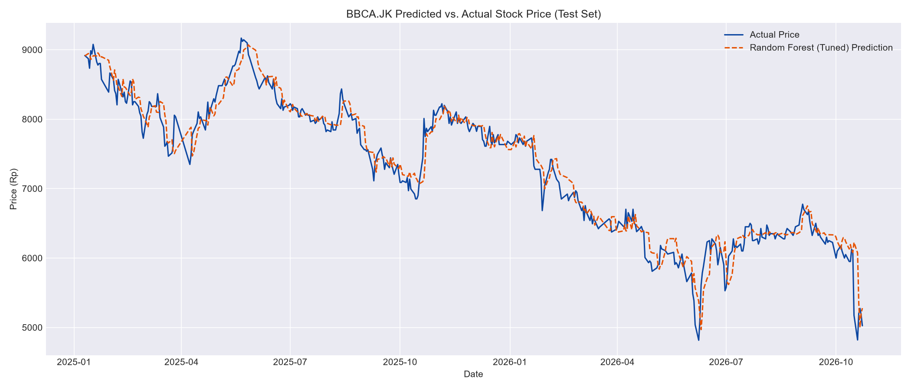

# BCA Stock Price Predictor

An end-to-end financial time-series engineering pipeline and interactive dashboard for forecasting **PT Bank Central Asia Tbk (`BBCA.JK`)** daily closing prices.

[Live Demo](https://bca-stock-predictor-demo1d.streamlit.app)

---

## Architecture Overview

Production machine learning systems separate **batch ingestion & model training** from **real-time inference & serving**. This repository implements a decoupled design:

```
[ Yahoo Finance API / Local Fallback ]
                  │
                  ▼
         src/data.py (Ingestion & Schema Validation)
                  │
                  ▼
         src/features.py (RSI, MA7/30/90, Volatility, Lags)
                  │
        ┌─────────┴─────────┐
        ▼                   ▼
  train.py (Batch)     app.py (Streamlit Serving)
  - TimeSeriesSplit     - Pre-trained Artifact Loading (<1s latency)
  - Hyperparameter CV   - Interactive Plotly Visualizations
  - Metric Evaluation   - Recursive Multi-Step Projections
        │                   │
        ▼                   ▼
  models/*.pkl         Live Dashboard / CSV Export
```

### Key Engineering Decisions
- **Decoupled Serving:** Training is removed from the web process to eliminate compute spikes and out-of-memory bottlenecks. The dashboard loads serialized model artifacts for sub-second responses.
- **Strict Temporal Separation:** Zero random shuffling in train/test splits. Target labels are strictly $y_{t+1}$ while features only use data up to $t$, preventing lookahead data leakage.
- **Resilient Ingestion:** Automatic fallback to validated local datasets (`data/bbca_raw.csv`) when the remote finance API experiences network timeouts or rate-limiting.
- **Modular Codebase:** Business logic, feature extraction, and ML pipelines reside in a clean `src/` module rather than monolithic scripts.

---

## Benchmark Results

Evaluated on 423 hold-out trading days (test split: 15% most recent observations):

| Model | RMSE (IDR) | MAE (IDR) | MAPE | $R^2$ | Directional Hit Rate |
| :--- | :---: | :---: | :---: | :---: | :---: |
| **Naive Baseline ($t-1$ persistence)** | **148.58** | **107.26** | **1.53%** | **0.9764** | 50.00% |
| **Linear Regression (OLS)** | 183.10 | 131.29 | 1.88% | 0.9642 | 49.65% |
| **Random Forest (Tuned)** | 215.31 | 157.75 | 2.27% | 0.9505 | 48.94% |



### Quantitative Engineering Takeaway
1. **The Random Walk Reality:** Stock price levels exhibit near unit-root non-stationarity. As demonstrated above, the naive persistence baseline ($y_t = y_{t-1}$) yields a lower RMSE than both Linear Regression and Random Forest.
2. **The $R^2$ Illusion:** A high $R^2$ (> 0.95) on raw stock price levels is primarily driven by autocorrelation (today's price is close to yesterday's price). Directional Hit Rate (~48.9%) confirms that price-derived technical features alone cannot reliably predict next-day sign changes without fundamental order book flow or macro sentiment signals.

---

## Project Structure

```
├── .github/
│   ├── dependabot.yml              # Automated dependency vulnerability scanning
│   └── workflows/
│       └── ci.yml                  # GitHub Actions CI workflow (lint & test)
├── data/
│   └── bbca_raw.csv                # Persisted historical candle dataset
├── images/                         # Plots and evaluation charts
├── models/
│   ├── random_forest_bbca_model.pkl# Serialized model artifact
│   ├── model_checksum.sha256       # Cryptographic integrity signature
│   └── evaluation_metrics.json     # Automated benchmark metrics
├── notebooks/
│   └── BCA_Stock_Prediction.ipynb  # Exploratory analysis & prototyping
├── src/
│   ├── __init__.py
│   ├── config.py                   # Centralized configuration & constants
│   ├── data.py                     # Data ingestion, fallback, schema validation
│   ├── features.py                 # Indicator calculation & lag matrix
│   └── models.py                   # Split, training, evaluation, recursive forecast
├── tests/
│   ├── __init__.py
│   ├── test_data.py                # Ingestion & validation assertions
│   ├── test_features.py            # Indicator tests & zero-leakage checks
│   └── test_models.py              # Temporal split & forecast shape verification
├── app.py                          # Streamlit serving application
├── train.py                        # Standalone batch pipeline runner
├── ruff.toml                       # Linter & code quality rules
├── requirements.txt                # Serving dependencies
└── requirements-dev.txt            # Development & testing dependencies
```

---

## Getting Started

### 1. Clone & Set Up Environment

```bash
git clone https://github.com/techrick-rgb/BCA-Stock-Predictor.git
cd BCA-Stock-Predictor

python -m venv venv
# Windows
venv\Scripts\activate
# macOS/Linux
source venv/bin/activate

pip install -r requirements-dev.txt
```

### 2. Run the Offline Training Pipeline

To ingest data, compute features, perform TimeSeriesSplit tuning, and save artifacts:

```bash
python train.py
```

### 3. Launch the Interactive Dashboard

```bash
streamlit run app.py
```

The serving application will open at `http://localhost:8501`. By default, it loads the serialized pre-trained artifact for instant inference.

### 4. Run Tests & Code Quality Checks

```bash
# Execute unit test suite (pytest or built-in unittest)
pytest -v tests/
python -m unittest discover -s tests -v

# Run code linter
ruff check .
```

---

## Methodology & Feature Pipeline

1. **Ingestion & Sanity Checks:** Validates required columns, monotonic dates, and removes invalid/zero pricing anomalies.
2. **Feature Engineering:**
   - **Trend:** Moving Averages (7, 30, and 90-day rolling means).
   - **Momentum:** 14-day Relative Strength Index (RSI).
   - **Volatility:** 30-day rolling standard deviation of daily percentage returns.
   - **Autoregressive Lags:** Historical closing prices at $t-1, t-2, t-3, t-5$.
3. **Temporal Split:** Sequential 85/15 train-test split without temporal shuffle.
4. **Validation:** `TimeSeriesSplit(n_splits=3)` cross-validation inside `GridSearchCV`.
5. **Multi-step Projections:** Recursive forecasting updating rolling windows iteratively.

---

## Known Limitations

- **Recursive Error Accumulation:** In multi-day forecasting ($N > 1$), each prediction relies on previous predictions, compounding variance over extended horizons.
- **Exogenous Variables:** Pure technical price features omit high-impact external signals such as central bank interest rate decisions, quarterly earnings reports, and foreign exchange movements.

---

## License

This project is licensed under the [MIT License](LICENSE).
